# FileMind — System Architecture Specification

**Document Version:** 1.0.0  
**Status:** Approved Architectural Specification  
**Architecture Style:** Local-First Hybrid Native Desktop (Tauri 2 + Rust + React 19 + SQLite)  

---

## 1. System Overview & Multi-Process Model

FileMind leverages **Tauri 2** as its desktop foundation, executing a secure, decoupled multi-process architecture:
1. **Frontend Web Process (UI):** Runs inside the native Windows **WebView2** runtime. Built with **React 19**, **TypeScript**, and **Tailwind CSS**. It is strictly responsible for presentation, layout orchestration, high-performance visualizations (treemaps, sunbursts, virtualized data tables), and user input dispatching. It holds no native OS privileges.
2. **Backend Native Process (Core Engine):** A compiled **Rust** systems binary that controls all OS interactions: Win32 API calls, direct NTFS traversal, cryptographic BLAKE3 hashing, SQLite database management, file lock checking, and atomic quarantine file moves.
3. **IPC Boundary:** Strongly typed, asynchronous message passing using Tauri 2's command invoke system and event streams. All payloads are serialized with `serde`.

```mermaid
graph TB
    subgraph Frontend["Frontend Layer (WebView2 / React 19 + TypeScript)"]
        UI_Shell["Desktop Shell & Navigation"]
        UI_Views["Views: Treemap / Search / Duplicates / Plans / Quarantine"]
        UI_Store["Client State Store (Zustand / Signals)"]
        UI_IPC["Tauri IPC Client (Typed Invokers & Event Listeners)"]
    end

    subgraph IPC_Boundary["Tauri 2 Typed IPC Boundary (JSON/Binary via Serde)"]
        Commands["Typed Tauri Commands (invoke)"]
        Events["Real-Time Event Streams (listen)"]
    end

    subgraph Native_Core["Rust Native Systems Engine"]
        Mod_Shell["1. Desktop Shell & Window Manager"]
        Mod_IPC["3. Typed IPC Command Dispatcher"]
        Mod_FS["4. Win32 Filesystem Adapter"]
        Mod_Scan["5. Parallel Storage Scanner"]
        Mod_Index["6. File Metadata Indexer"]
        Mod_Dup["7. Multi-Stage Duplicate Detector"]
        Mod_Safety["8. Deterministic Safety Engine"]
        Mod_Plan["9. Cleanup Planner"]
        Mod_Op["10. Atomic File Operation Manager"]
        Mod_Quar["11. Quarantine & Recovery Vault"]
        Mod_Jobs["12. Background Job Coordinator"]
        Mod_Sched["13. Automation Scheduler"]
        Mod_Search["14. FTS5 Search & Document Extractor"]
        Mod_AI["15. Optional Ollama AI Copilot"]
        Mod_Diag["16. Tracing, Logging & Diagnostics"]
        Mod_Config["17. Application Settings Store"]
        Mod_Migrate["18. Database Migration Engine"]
    end

    subgraph Persistence["Local Persistence & OS Storage"]
        DB[("SQLite 3.45+ (WAL, FTS5)")]
        Vault["Per-Volume Quarantine Vaults (.filemind_quarantine)"]
        Audit["Append-Only Audit Log"]
        WinAPI["Windows Win32 Kernel APIs (NTFS / MFT / IFileOperation)"]
    end

    UI_Shell --> UI_Store
    UI_Views --> UI_Store
    UI_Store --> UI_IPC
    UI_IPC <--> Commands
    UI_IPC <--> Events
    Commands --> Mod_IPC
    Mod_IPC --> Native_Core
    Events <-- Native_Core
    Mod_FS --> WinAPI
    Mod_Index --> DB
    Mod_Search --> DB
    Mod_Quar --> Vault
    Mod_Op --> Audit
```



---

## 2. Module Specifications (The 18 Core Modules)

### Module 1: Desktop Shell
- **Role:** Controls application window life-cycle, frameless titlebar integration, system tray icon, native menus, window state persistence (geometry, maximized state, multi-monitor coordinates), and light/dark theme synchronization with Windows OS settings.
- **Implementation:** Rust `tauri::window::WindowBuilder` with custom Windows acrylic/mica styling disabled to adhere to the Impeccable paper-neutral design system.

### Module 2: Frontend State and Navigation
- **Role:** Manages client-side navigation between core views:
  - *Storage Visualizer* (Treemap / Sunburst / Table)
  - *File Index & FTS5 Search*
  - *Duplicate Detection Hub*
  - *Developer Workspace & Cache Manager*
  - *Cleanup Planner & Impact Review*
  - *Quarantine & Recovery Vault*
  - *Automation Rules*
  - *Settings & Diagnostics*
  - *Advisory Copilot Drawer* (conditional on Ollama availability)
- **Implementation:** React 19, custom memory-efficient client stores (Zustand), virtualized table rendering (`@tanstack/react-virtual` for 100,000+ row tables at 60fps).

### Module 3: Typed Tauri Command Interface
- **Role:** Enforces end-to-end type safety between TypeScript and Rust. All commands return `Result<T, AppError>`, where `AppError` is a structured enum serialized into detailed error payloads with actionable user remediation.
- **Key Commands:**
  - `start_scan(path: String, options: ScanOptions) -> Result<ScanJobId, AppError>`
  - `cancel_job(job_id: JobId) -> Result<(), AppError>`
  - `generate_cleanup_plan(criteria: PlanCriteria) -> Result<CleanupPlan, AppError>`
  - `execute_quarantine(plan_id: PlanId, item_ids: Vec<ItemId>) -> Result<QuarantineReport, AppError>`
  - `restore_quarantined_items(manifest_id: String, item_ids: Vec<String>) -> Result<RestoreReport, AppError>`
  - `purge_quarantine_items(manifest_id: String, item_ids: Vec<String>) -> Result<PurgeReport, AppError>`
  - `query_duplicates(options: DupQueryOptions) -> Result<DuplicateGroupList, AppError>`
  - `search_index(query: SearchQuery) -> Result<SearchResults, AppError>`
  - `ask_copilot(prompt: String) -> Result<CopilotProposal, AppError>`

### Module 4: Filesystem Adapter
- **Role:** Abstracted Windows filesystem interface wrapping low-level Win32 APIs.
- **Responsibilities:**
  - Prefixes all paths with `\\?\` to support Windows Long Paths up to 32,767 characters.
  - Queries NTFS reparse point tags to identify symlinks, directory junctions, and OneDrive cloud stubs (`FILE_ATTRIBUTE_REPARSE_POINT`).
  - Queries file attributes (`FILE_ATTRIBUTE_HIDDEN`, `FILE_ATTRIBUTE_SYSTEM`, `FILE_ATTRIBUTE_READONLY`).
  - Obtains volume information, cluster sizes, and physical size on disk (`GetCompressedFileSizeW`).
  - Tests file sharing locks via `CreateFileW` with `dwShareMode = 0`.

### Module 5: Storage Scanner
- **Role:** High-throughput parallel directory traversal engine.
- **Design:**
  - Uses a work-stealing threadpool (`rayon` or `crossbeam-channel`) configured with worker count matching CPU core count.
  - Calls `SetThreadPriority(THREAD_MODE_BACKGROUND_BEGIN)` to ensure scanning never causes UI stutter or interferes with user workloads.
  - Emits batched progress events to the frontend at a rate-limited cadence (maximum 10 events per second) to prevent IPC channel congestion.
  - Employs cycle-detection tracking device and file IDs (`BY_HANDLE_FILE_INFORMATION`) to prevent infinite recursion on circular NTFS junctions.

### Module 6: File Metadata Index
- **Role:** Persists scanned file metadata into a high-performance local SQLite database.
- **Optimization:**
  - Batched inserts using SQLite multi-row transactions (`BEGIN IMMEDIATE TRANSACTION ... COMMIT`) processing 20,000 rows/second.
  - Stores hierarchical directory relationships with precomputed ancestor paths for instant subtree aggregations.
  - Maintains indexes on `(size, extension)`, `(parent_id)`, and `(mtime)`.

### Module 7: Duplicate Detection
- **Role:** Deterministic, multi-stage duplicate identification.
- **Pipeline:**
  ```mermaid
  flowchart LR
      AllFiles["Indexed Files"] --> S1["Stage 1: Size Match (>0 bytes)"]
      S1 --> S2["Stage 2: 4KB Head & Tail Hash (BLAKE3)"]
      S2 --> S3["Stage 3: Full File Cryptographic Hash (BLAKE3)"]
      S3 --> S4["Stage 4: NTFS Hardlink Check (File ID)"]
      S4 --> Dupes["Verified Duplicates Group"]
  ```
  - Discards unique file sizes instantly without reading disk blocks.
  - Reads only the first 4KB and last 4KB for size-matched candidates, eliminating 95% of non-duplicates.
  - Streams full contents for remaining candidates using multi-threaded BLAKE3 (>1.5 GB/s).
  - Verifies whether files share the same NTFS MFT Record (`nFileIndexHigh`/`nFileIndexLow`); identical MFT records indicate hardlinks (zero additional disk space consumed) and are flagged separately.

### Module 8: Safety and Dependency Engine
- **Role:** The core arbiter of file operation safety. Evaluates every target path against an immutable rule hierarchy.
- **Invariant:** **"Unknown is Unsafe."** If a file does not match a verified positive rule, it cannot be categorized as Safe.
- **Safety Checks:**
  1. *OS Protected Roots:* Denylists `C:\Windows`, `C:\Program Files\WindowsApps`, `EFI`, `System Volume Information`, `$Recycle.Bin`.
  2. *Active Process Locking:* Uses Windows Restart Manager API (`RmStartSession`, `RmRegisterResources`, `RmGetList`) to detect if an active application holds a lock on the target.
  3. *Repository Cleanliness:* Evaluates `.git/` status; uncommitted modifications or untracked source files escalate safety tier to High Risk.
  4. *Project Manifests:* Confirms directory context (e.g., verifying `node_modules` is accompanied by a valid `package.json` before classifying as disposable build cache).

### Module 9: Cleanup Planner
- **Role:** Converts scan insights and user rules into actionable, structured **Cleanup Plans**.
- **Outputs:**
  - Itemized manifest of targets, categorized by Risk Tier (Safe, Caution, High Risk, Danger).
  - Total recoverable bytes and cluster savings.
  - Projected downstream impact warnings (e.g., "Deleting Gradle cache will require online re-download on next build").
  - Plan dry-run visualization presented in the UI for mandatory user confirmation.

### Module 10: File Operation Manager
- **Role:** Executes approved operations with transactional integrity and safety guarantees.
- **Mechanisms:**
  - Pre-flight re-verification: Verifies that target size, modified time, and file hash have not changed between plan generation and execution (mitigating TOCTOU race conditions).
  - Sequential rollback logging: If an operation is cancelled or errors midway, previously moved files remain in quarantine and the manifest reflects exact completed items.
  - Windows I/O error translation: Maps Win32 error codes (`ERROR_ACCESS_DENIED`, `ERROR_SHARING_VIOLATION`, `ERROR_DISK_FULL`) into clear, human-readable diagnostics.

### Module 11: Quarantine and Recovery
- **Role:** Two-stage recoverable file isolation.
- **Zero-Copy Architecture:**
  - To prevent slow, cross-drive data transfers, FileMind maintains a hidden `.filemind_quarantine` directory at the root of **each** drive volume (e.g., `C:\.filemind_quarantine`, `D:\.filemind_quarantine`).
  - Files are moved into quarantine using Win32 `MoveFileExW` with `MOVEFILE_WRITE_THROUGH`. On NTFS, this is an instant, atomic metadata pointer update requiring zero block copying.
- **Manifest:** Stores full original path, ACLs, creation/access/modification timestamps, and content hash in a cryptographically validated JSON manifest and SQLite table.
- **Rollback:** Restores files to their exact original location with restored timestamps and attributes with one click.

### Module 12: Background Jobs
- **Role:** Manages long-running asynchronous tasks (full volume scans, deep duplicate hashing, FTS5 document indexing).
- **Control:** Provides fine-grained pause, resume, and cancellation primitives using atomic flags (`Arc<AtomicBool>`).
- **Telemetry:** Exposes progress counters (files scanned, bytes read, current path) via Tauri event channels.

### Module 13: Automation Scheduler
- **Role:** Manages recurring file health tasks and automated quarantine schedules.
- **Design:**
  - Evaluates user-defined triggers (e.g., "Weekly on Sunday at 2:00 AM", or "When drive free space drops below 15%").
  - Restricts automated actions strictly to Tier 1 ("Safe") items.
  - Integrates with Windows Task Scheduler or runs as a quiet tray background loop.

### Module 14: Search and Document Extraction
- **Role:** Powers instant search and deep content retrieval.
- **Text Extraction:**
  - Safe, sandboxed text parsers for plain text, Markdown, JSON, YAML, TOML, source code, PDF, and DOCX.
  - Strict allocation cap: Max 10MB file extraction size to prevent memory bloat.
  - SQLite FTS5 table indexing with Unicode61 tokenizer and porter stemmer.

### Module 15: Optional AI Provider
- **Role:** Connects to local Ollama runtime to provide advisory analysis.
- **Strict Isolation Architecture:**
  ```mermaid
  sequenceDiagram
      actor User
      participant Frontend as Tauri UI
      participant AI as Ollama Client
      participant Safety as Rust Safety Engine
      participant Disk as Local Filesystem

      User->>Frontend: "Why is AppData so large?"
      Frontend->>AI: Send prompt + sanitized directory summaries
      AI-->>Frontend: "Suggest cleaning Spotify cache (12GB)"
      User->>Frontend: "Create cleanup plan"
      Frontend->>Safety: Validate proposed paths
      Note over Safety: Checks process locks, system roots,<br/>package manifests, and risk tiers.
      Safety-->>Frontend: Return Verified Plan (Tier 1: Safe)
      User->>Frontend: User clicks "Confirm Quarantine"
      Frontend->>Disk: Atomic move to .filemind_quarantine
  ```
  - The AI model has **zero direct filesystem write privileges**. It receives strictly sanitized directory summaries and emits typed JSON proposals.
  - All proposals must pass through Module 8 (Safety Engine) and require explicit user UI approval.

### Module 16: Diagnostics and Logging
- **Role:** Provides transparent, local-only operational records.
- **Implementation:** Rust `tracing` and `tracing-subscriber` writing rolling daily logs to `%LOCALAPPDATA%\FileMind\logs`.
- **Privacy:** Log files automatically scrub sensitive user profile names and personal path elements.

### Module 17: Application Settings
- **Role:** Stores user preferences (excluded paths, scan throttling, theme preferences, retention policies, Ollama endpoints).
- **Format:** SQLite `app_settings` table combined with a typed schema.

### Module 18: Database Migrations
- **Role:** Manages schema evolution without data loss.
- **Mechanism:** Linear, versioned migration scripts tracked via SQLite `PRAGMA user_version`. Each migration runs inside an isolated atomic transaction.

---

## 3. Data Flow Sequences

### 3.1 High-Speed Scan & Index Sequence
1. User selects target drive or folder (e.g., `D:\Projects`).
2. Frontend issues `start_scan(path)`.
3. Rust backend spawns scanner threadpool with `THREAD_MODE_BACKGROUND_BEGIN`.
4. Work-stealing workers traverse directories, resolving NTFS attributes and sizes.
5. Workers stream directory entries into a high-capacity crossbeam channel.
6. A dedicated database writer thread batches entries into SQLite (20,000 rows/transaction).
7. Progress throttling timer emits `scan:progress` events to UI every 100ms.
8. On completion, `scan:finished` event sends summary statistics to frontend.

### 3.2 Two-Stage Quarantine Sequence
1. User reviews Cleanup Plan in UI and confirms items for quarantine.
2. Frontend sends `execute_quarantine(plan_id, selected_item_ids)`.
3. Rust engine verifies volume root and ensures `.filemind_quarantine` directory exists on the target volume.
4. For each item:
   - Re-checks file attributes, size, and modified time against initial scan.
   - Pre-tests file lock using Win32 `CreateFileW`.
   - Generates unique UUID for the quarantined artifact.
   - Performs atomic `MoveFileExW` into the volume quarantine vault.
   - Writes record into `quarantine_manifests` and `quarantine_items` database tables.
   - Writes immutable entry to audit log.
5. Emits `quarantine:completed` report with success/failure breakdown.

