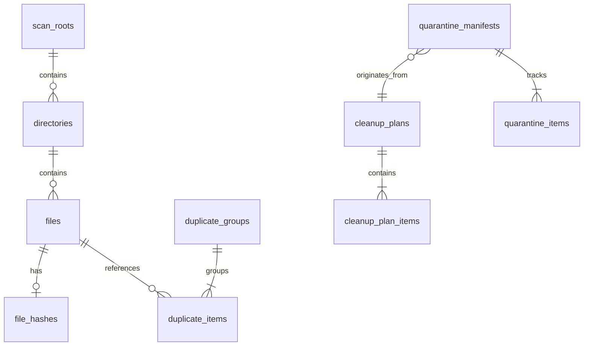

# FileMind — Database Architecture & Schema Specification

**Document Version:** 1.0.0  
**Database Engine:** SQLite 3.45+ (bundled via `rusqlite` with `bundled-fts5` feature)  
**Status:** Approved Schema Specification  

---

## 1. Engine Configuration & Pragmas

FileMind uses an embedded **SQLite** database located in the user's application data directory:
`%LOCALAPPDATA%\FileMind\filemind.db`

To support sustained high-speed insertions during multi-threaded scanning while serving responsive UI queries, the following pragmas are executed on every database connection:

```sql
-- Enable Write-Ahead Logging for high-concurrency read/write operations
PRAGMA journal_mode = WAL;

-- Optimize disk flushes: safe against OS crashes, high performance on modern SSDs
PRAGMA synchronous = NORMAL;

-- Enforce foreign key constraints
PRAGMA foreign_keys = ON;

-- Wait up to 5000ms if database is locked by background indexer
PRAGMA busy_timeout = 5000;

-- Allocate 64MB memory cache for index queries (-64000 in KiB)
PRAGMA cache_size = -64000;

-- Keep temporary tables and index sorts in RAM
PRAGMA temp_store = MEMORY;

-- Enable auto-vacuuming to reclaim space after large purges
PRAGMA auto_vacuum = INCREMENTAL;
```

---

## 2. Entity-Relationship Model



---

## 3. Schema DDL Definitions

### 3.1 Scan Roots & Directory Hierarchy

```sql
CREATE TABLE IF NOT EXISTS scan_roots (
    root_id INTEGER PRIMARY KEY AUTOINCREMENT,
    path TEXT NOT NULL UNIQUE,
    volume_guid TEXT NOT NULL,
    volume_label TEXT,
    filesystem_type TEXT NOT NULL, -- 'NTFS', 'ReFS', 'exFAT'
    cluster_size_bytes INTEGER NOT NULL,
    total_bytes INTEGER NOT NULL,
    free_bytes INTEGER NOT NULL,
    last_scanned_at INTEGER -- Unix epoch ms
);

CREATE TABLE IF NOT EXISTS directories (
    directory_id INTEGER PRIMARY KEY AUTOINCREMENT,
    root_id INTEGER NOT NULL REFERENCES scan_roots(root_id) ON DELETE CASCADE,
    parent_id INTEGER REFERENCES directories(directory_id) ON DELETE CASCADE,
    path TEXT NOT NULL UNIQUE,
    depth INTEGER NOT NULL,
    total_size_bytes INTEGER NOT NULL DEFAULT 0,
    file_count INTEGER NOT NULL DEFAULT 0,
    dir_count INTEGER NOT NULL DEFAULT 0,
    mtime INTEGER NOT NULL,
    attributes INTEGER NOT NULL DEFAULT 0
);

CREATE INDEX IF NOT EXISTS idx_directories_parent ON directories(parent_id);
CREATE INDEX IF NOT EXISTS idx_directories_path ON directories(path);
```

### 3.2 File Metadata & Hashing Pipeline

```sql
CREATE TABLE IF NOT EXISTS files (
    file_id INTEGER PRIMARY KEY AUTOINCREMENT,
    directory_id INTEGER NOT NULL REFERENCES directories(directory_id) ON DELETE CASCADE,
    filename TEXT NOT NULL,
    extension TEXT NOT NULL,
    logical_size_bytes INTEGER NOT NULL,
    physical_size_bytes INTEGER NOT NULL, -- Physical allocation on disk
    attributes INTEGER NOT NULL, -- Win32 File Attributes bitmask
    ctime INTEGER NOT NULL, -- Creation time
    mtime INTEGER NOT NULL, -- Last write time
    atime INTEGER NOT NULL, -- Last access time
    ntfs_file_id TEXT -- High/Low 64-bit MFT record ID for hardlink detection
);

CREATE INDEX IF NOT EXISTS idx_files_directory ON files(directory_id);
CREATE INDEX IF NOT EXISTS idx_files_size_ext ON files(logical_size_bytes, extension);
CREATE INDEX IF NOT EXISTS idx_files_mtime ON files(mtime);
CREATE INDEX IF NOT EXISTS idx_files_ntfs_id ON files(ntfs_file_id);

CREATE TABLE IF NOT EXISTS file_hashes (
    file_id INTEGER PRIMARY KEY REFERENCES files(file_id) ON DELETE CASCADE,
    sparse_hash TEXT, -- BLAKE3 hash of first 4KB + last 4KB
    full_hash TEXT,   -- Complete BLAKE3 cryptographic hash
    computed_at INTEGER NOT NULL
);

CREATE INDEX IF NOT EXISTS idx_hashes_sparse ON file_hashes(sparse_hash) WHERE sparse_hash IS NOT NULL;
CREATE INDEX IF NOT EXISTS idx_hashes_full ON file_hashes(full_hash) WHERE full_hash IS NOT NULL;
```

### 3.3 Duplicate Detection Groups

```sql
CREATE TABLE IF NOT EXISTS duplicate_groups (
    group_id INTEGER PRIMARY KEY AUTOINCREMENT,
    full_hash TEXT NOT NULL UNIQUE,
    file_size_bytes INTEGER NOT NULL,
    file_count INTEGER NOT NULL,
    total_wasted_bytes INTEGER NOT NULL, -- (file_count - 1) * file_size_bytes
    created_at INTEGER NOT NULL
);

CREATE TABLE IF NOT EXISTS duplicate_items (
    group_id INTEGER NOT NULL REFERENCES duplicate_groups(group_id) ON DELETE CASCADE,
    file_id INTEGER NOT NULL REFERENCES files(file_id) ON DELETE CASCADE,
    is_canonical INTEGER NOT NULL DEFAULT 0, -- 1 = designated copy to keep
    is_hardlink INTEGER NOT NULL DEFAULT 0,  -- 1 = shares NTFS MFT record
    PRIMARY KEY (group_id, file_id)
);
```

### 3.4 Safety Rules & Cleanup Planning

```sql
CREATE TABLE IF NOT EXISTS safety_rules (
    rule_id INTEGER PRIMARY KEY AUTOINCREMENT,
    rule_name TEXT NOT NULL,
    rule_type TEXT NOT NULL, -- 'PATH_GLOB', 'REGEX', 'PROCESS_LOCK', 'MANIFEST_CHECK'
    pattern TEXT NOT NULL,
    risk_tier INTEGER NOT NULL, -- 1: Safe, 2: Caution, 3: High Risk, 4: Danger/Blocked
    description TEXT NOT NULL,
    is_builtin INTEGER NOT NULL DEFAULT 1,
    is_enabled INTEGER NOT NULL DEFAULT 1
);

CREATE TABLE IF NOT EXISTS cleanup_plans (
    plan_id TEXT PRIMARY KEY, -- UUID v4
    created_at INTEGER NOT NULL,
    status TEXT NOT NULL, -- 'DRAFT', 'APPROVED', 'EXECUTED', 'CANCELLED'
    total_items INTEGER NOT NULL,
    total_reclaimable_bytes INTEGER NOT NULL,
    risk_breakdown_json TEXT NOT NULL
);

CREATE TABLE IF NOT EXISTS cleanup_plan_items (
    plan_id TEXT NOT NULL REFERENCES cleanup_plans(plan_id) ON DELETE CASCADE,
    file_id INTEGER NOT NULL REFERENCES files(file_id) ON DELETE CASCADE,
    original_path TEXT NOT NULL,
    size_bytes INTEGER NOT NULL,
    risk_tier INTEGER NOT NULL,
    safety_rationale TEXT NOT NULL,
    user_override INTEGER NOT NULL DEFAULT 0, -- 1 if user explicitly promoted/demoted
    is_selected INTEGER NOT NULL DEFAULT 1,
    PRIMARY KEY (plan_id, file_id)
);
```

### 3.5 Quarantine Vault & Rollback Manifests

```sql
CREATE TABLE IF NOT EXISTS quarantine_manifests (
    manifest_id TEXT PRIMARY KEY, -- UUID v4
    plan_id TEXT REFERENCES cleanup_plans(plan_id),
    volume_root TEXT NOT NULL, -- e.g. 'C:\'
    vault_path TEXT NOT NULL,  -- e.g. 'C:\.filemind_quarantine\vault_<id>'
    created_at INTEGER NOT NULL,
    status TEXT NOT NULL, -- 'ACTIVE', 'PARTIALLY_RESTORED', 'FULLY_RESTORED', 'PURGED'
    total_items INTEGER NOT NULL,
    total_bytes INTEGER NOT NULL
);

CREATE TABLE IF NOT EXISTS quarantine_items (
    manifest_id TEXT NOT NULL REFERENCES quarantine_manifests(manifest_id) ON DELETE CASCADE,
    item_id TEXT PRIMARY KEY, -- UUID v4
    original_path TEXT NOT NULL,
    quarantined_relative_path TEXT NOT NULL,
    file_size_bytes INTEGER NOT NULL,
    mtime INTEGER NOT NULL,
    file_hash TEXT NOT NULL,
    acl_security_descriptor TEXT, -- Base64 encoded SDDL security descriptor
    status TEXT NOT NULL, -- 'QUARANTINED', 'RESTORED', 'PURGED'
    restored_at INTEGER,
    purged_at INTEGER
);

CREATE INDEX IF NOT EXISTS idx_quarantine_items_manifest ON quarantine_items(manifest_id);
```

### 3.6 Full-Text Document Indexing (SQLite FTS5)

```sql
CREATE VIRTUAL TABLE IF NOT EXISTS fts_documents USING fts5(
    file_id UNINDEXED,
    filename,
    extension,
    content,
    tokenize = 'unicode61 remove_diacritics 2'
);
```

### 3.7 Automation, Settings & Security Audit Ledger

```sql
CREATE TABLE IF NOT EXISTS scheduled_tasks (
    task_id TEXT PRIMARY KEY,
    name TEXT NOT NULL,
    schedule_cron TEXT NOT NULL,
    criteria_json TEXT NOT NULL,
    auto_quarantine INTEGER NOT NULL DEFAULT 0,
    last_run_at INTEGER,
    next_run_at INTEGER,
    is_active INTEGER NOT NULL DEFAULT 1
);

CREATE TABLE IF NOT EXISTS app_settings (
    setting_key TEXT PRIMARY KEY,
    setting_value_json TEXT NOT NULL,
    updated_at INTEGER NOT NULL
);

CREATE TABLE IF NOT EXISTS audit_logs (
    log_id INTEGER PRIMARY KEY AUTOINCREMENT,
    timestamp INTEGER NOT NULL,
    event_type TEXT NOT NULL, -- 'SCAN', 'PLAN_GEN', 'QUARANTINE', 'RESTORE', 'PURGE', 'AUTOMATION'
    severity TEXT NOT NULL,   -- 'INFO', 'WARN', 'ERROR', 'SECURITY'
    details_json TEXT NOT NULL
);

CREATE INDEX IF NOT EXISTS idx_audit_timestamp ON audit_logs(timestamp);
```

---

## 4. Migration & Schema Evolution Strategy

Database migrations are tracked using SQLite's internal version register:
`PRAGMA user_version;`

1. **Transactional Migrations:** Every migration step runs inside `BEGIN IMMEDIATE TRANSACTION;` and `COMMIT;`. If any DDL statement fails, the entire transaction rolls back cleanly.
2. **Backward Compatibility:** Upgrades preserve all existing quarantine records and user configuration.
3. **Backup Before Migration:** When updating from a previous schema version, the engine creates a copy of `filemind.db` (`filemind.db.bak_v{old}`) prior to executing the migration script.

