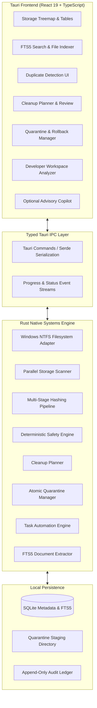

# FileMind — Product Requirements Document (PRD)

**Document Version:** 1.0.0  
**Status:** Approved Architectural Specification  
**Classification:** Core System Specification  

---

## 1. Executive Summary & Product Vision

Modern personal workstations accumulate hundreds of gigabytes of ephemeral and redundant data: unbounded developer dependencies (`node_modules`, `.cargo`, `target`, Python virtual environments), build outputs, package manager caches, media editing scratch disks, duplicate downloads, and orphaned system caches. Existing disk cleaning tools for Windows tend to fall into two problematic extremes:
1. **Opaque "Magic" Cleaners:** Utilities that delete files behind vague labels ("System Junk") without exposing underlying paths, running risks of breaking developer tooling, game installations, or uncommitted project source code.
2. **Raw Command-Line Scripts / Unassisted Trees:** Fast utilities (such as WizTree or WinDirStat) that visualize storage well but leave all judgment, safety analysis, and recovery burdens entirely on the user.

**FileMind** bridges this divide by delivering an **evidence-based, deterministic, local-first storage intelligence platform** for Windows. It combines deep NTFS storage visualization, lightning-fast metadata and content indexing, multi-stage duplicate identification, dependency-aware safety scoring, intelligent cleanup planning, and atomic, recoverable quarantine operations.

FileMind operates on three foundational tenets:
- **Local-First & Offline Invariant:** Zero mandatory telemetry, zero paid cloud backends, zero external API dependencies. All analysis and indexing remain on the local machine.
- **Safety Over Speed:** "Unknown safety is never safe." No file is purged without explicit evaluation against process locks, protected system directories, and project dependency trees. Every operation defaults to a reversible quarantine vault.
- **AI as an Isolated Advisory Copilot:** An optional local AI assistant (powered by local Ollama instances) provides natural-language inquiries and contextual cleanup suggestions. The AI has **zero direct filesystem write privileges** and operates exclusively through strictly typed, read-only inspection tools.

---

## 2. Target User Personas & Real-World Scenarios

### 2.1 Persona A: The Full-Stack / Systems Developer ("Alex")
- **Profile:** Works across Rust, TypeScript/Node, and Python projects. Has 50+ repositories in `~/Workspace`.
- **Pain Point:** Disk space continually runs low because every project has its own `node_modules` (often 500MB+ each), Rust `target/` directories (often 10GB+ each), and Python `.venv` folders. Standard cleaners either ignore these or risk deleting active work.
- **User Journey:** Alex opens FileMind's **Developer Workspace Analyzer**, which groups projects by ecosystem, shows git status (clean vs. dirty/uncommitted), last modified timestamp, and total space consumed by build artifacts. Alex safely selects "Clean build artifacts on inactive repositories older than 30 days with clean git status," staging 85GB into quarantine with one click.

### 2.2 Persona B: The Content Creator & Digital Media Specialist ("Maya")
- **Profile:** Edits 4K video footage and photographic assets across multiple internal SSDs and external drives.
- **Pain Point:** Huge duplicate raw files, proxy files, and render caches scattered across folders, with lingering fear of deleting active client footage.
- **User Journey:** Maya runs the **Multi-Stage Duplicate Detector** over `D:\VideoProjects`. FileMind performs instant size grouping, followed by sparse 4KB block hashing and BLAKE3 verification. It identifies 140GB of exact duplicates while highlighting which copies are referenced inside Premiere/Resolve project files.

### 2.3 Persona C: The Power User & System Caretaker ("David")
- **Profile:** Manages a Windows 11 workstation with heavy everyday usage (downloads, game launchers, temporary installers).
- **Pain Point:** C: drive red-lining at 95% capacity; unsure what is occupying space or whether clearing unknown folders in `AppData\Local` will brick installed applications.
- **User Journey:** David runs the **Storage Visualizer**, which renders a responsive, high-density treemap. Clicking on bloated directories triggers the **Safety & Dependency Engine**, which flags cache directories as "Safe to Clear" while explicitly labeling user configs as "Protected". David generates an **Intelligent Cleanup Plan** and reviews the dry-run diff before staging files into quarantine.

---

## 3. Core Functional Requirements

### FR-1: Storage Analysis & Visualization
- **FR-1.1:** The engine shall scan arbitrary Windows drive volumes (NTFS, ReFS, exFAT) and directory paths using high-throughput multi-threaded directory traversal.
- **FR-1.2:** The scanner must properly resolve cluster allocation, physical size on disk, logical file size, and sparse file allocations.
- **FR-1.3:** The frontend shall render a multi-level interactive treemap and nested sunburst visualization capable of rendering 100,000+ nodes at 60fps without UI stutter.
- **FR-1.4:** The user shall be able to filter the visualizer by file extension, size thresholds, creation/modification dates, and file category (Media, Code, Archives, Documents, Binaries).
- **FR-1.5:** The visualizer must provide high-density compact breakdown tables displaying exact file paths, byte sizes, item counts, and percentage of parent allocation.

### FR-2: File Indexing & Search
- **FR-2.1:** High-speed SQLite-backed indexing engine storing filename, directory hierarchy, logical size, physical size, attributes (hidden, system, archive, read-only), creation time, last access time, and last write time.
- **FR-2.2:** Real-time incremental search across millions of indexed files with response latency under 50 milliseconds.
- **FR-2.3:** Full-text document content search powered by SQLite FTS5 with BM25 relevance ranking.
- **FR-2.4:** Safe, read-only text extraction for plain text, markdown, source code (`.rs`, `.ts`, `.py`, `.json`, etc.), PDF, and DOCX documents with strict size caps (maximum 10MB per document extraction).
- **FR-2.5:** Wildcard, regular expression, and structured query syntax (e.g., `ext:log size:>100MB mtime:<30d`).

### FR-3: Multi-Stage Duplicate Detection
- **FR-3.1:** Multi-stage deterministic duplicate detection pipeline:
  - **Stage 1 (Size Partitioning):** Group candidate files by identical byte-exact logical file size. Discard unique sizes immediately.
  - **Stage 2 (Sparse Block Hashing):** Compute cryptographic hashes (BLAKE3) of the first 4KB and last 4KB of matching candidates.
  - **Stage 3 (Full Cryptographic Hash):** Stream and hash the full file contents using BLAKE3 (yielding >2GB/s throughput per core on modern CPUs).
  - **Stage 4 (Byte-by-Byte Verification):** Optional final byte verification pass for mission-critical operations.
- **FR-3.2:** NTFS Hardlink & Reparse Point Awareness: The engine must detect whether two directory entries point to the same NTFS file ID/MFT record (hardlinks) to avoid false-positive duplicate reporting.
- **FR-3.3:** Duplicate selection helpers: "Keep Newest", "Keep Oldest", "Keep Shortest Path", "Keep in Designated Canonical Folder", and "Manual Selection".

### FR-4: Evidence-Based File Safety & Dependency Analysis
- **FR-4.1:** Deterministic safety scoring engine assigning one of four explicit risk levels:
  - **Safe (Tier 1):** Known disposable caches, temporary build targets with clean parent git repositories, standard temp folders older than 7 days.
  - **Caution (Tier 2):** Inactive application caches, large log archives, unreferenced downloads older than 90 days.
  - **High Risk (Tier 3):** User documents, configuration files, modified source files, files in uncommitted git repositories.
  - **Danger / Blocked (Tier 4):** Windows system files (`C:\Windows`), Boot configuration, Active process binaries, files with active Windows sharing locks, registry hives, and critical system volumes.
- **FR-4.2:** **Unknown is Unsafe:** If a file or directory does not match a verified, positive safety rule, its safety score MUST default to High Risk or Blocked.
- **FR-4.3:** Real-time Windows file-lock detection using Win32 `CreateFileW` with zero sharing flags (`0`) and `Restart Manager` API integration to identify locking process IDs.
- **FR-4.4:** Dependency tree awareness: Verifying package manifests (`package.json`, `Cargo.toml`, `requirements.txt`) and git repository cleanliness before scoring build directories.

### FR-5: Intelligent Cleanup Planning
- **FR-5.1:** Rule-driven cleanup recommendation generation based on user preferences and disk pressure.
- **FR-5.2:** Comprehensive dry-run preview: Every plan displays exact file counts, total bytes to reclaim, detailed itemized breakdown, and safety score rationale.
- **FR-5.3:** Tiered approval gates: Items rated "Safe" can be approved in bulk; items rated "Caution" or "High Risk" require individual explicit user confirmation.
- **FR-5.4:** Impact assessment: Highlighting potential consequences (e.g., "Deleting this cache will require `npm install` on next build").

### FR-6: Quarantine & Recoverable File Operations
- **FR-6.1:** **Two-Stage Atomic Quarantine:** Files slated for cleanup are NEVER permanently deleted directly. They are moved into an isolated, user-accessible Quarantine Vault located on the same drive volume (enabling instant, atomic NTFS metadata moves without data copying).
- **FR-6.2:** Quarantine Manifest: Every quarantine operation writes an atomic JSON/SQLite manifest recording:
  - Unique Quarantine ID
  - Original canonical absolute path
  - File size, creation date, modification date, file attributes
  - SHA256/BLAKE3 hash of content
  - Originating cleanup plan ID and timestamp
  - Access Control List (ACL) security descriptor
- **FR-6.3:** Complete Rollback Engine: One-click restoration of any quarantined item or entire batch back to its original location with full fidelity.
- **FR-6.4:** Configurable Vault Retention & Purge: User-controlled auto-purge policies (e.g., "Retain in quarantine for 30 days before permanent deletion").
- **FR-6.5:** Permanent Purge: Explicit user command to permanently delete quarantined files using Windows Recycle Bin APIs (`IFileOperation`) or secure deletion.

### FR-7: Developer Workspace & Cache Analysis
- **FR-7.1:** Native detection and specialized inspection of major developer ecosystems:
  - Node.js / JavaScript (`node_modules`, `.next`, `.turbo`, `.parcel-cache`, npm/pnpm/yarn global caches)
  - Rust (`target/`, `~/.cargo/registry/cache`, `sccache`)
  - Python (`__pycache__`, `.venv`, `venv`, pip cache, poetry/pipenv caches)
  - Go (`~/go/pkg/mod`, build caches)
  - Java / JVM (`.gradle/caches`, `.m2/repository`)
  - Docker Desktop (virtual disk images, stopped containers, dangling images, buildkit cache)
  - IDEs (VS Code workspace storage, JetBrains system caches)
- **FR-7.2:** Git Status Integration: Reading `.git` status to determine whether a repository has uncommitted changes, stashes, or untracked source files before suggesting cache purges.

### FR-8: Configurable File Automation
- **FR-8.1:** Declarative automation rules defined by the user (e.g., "Quarantine files in `~/Downloads` matching `*.iso` older than 60 days").
- **FR-8.2:** Safe execution engine: Automated tasks run with lowest priority and only execute operations rated "Safe". Any condition triggering "Caution" or higher pauses the task and posts a desktop notification for manual review.
- **FR-8.3:** Windows Task Scheduler integration or native background service option.

### FR-9: Optional Advisory Desktop Copilot
- **FR-9.1:** Local-Only LLM Integration: Direct connection to local Ollama endpoints (e.g., `http://127.0.0.1:11434`) running models such as Llama 3, Mistral, or Qwen.
- **FR-9.2:** **Zero Direct Filesystem Privileges:** The LLM cannot invoke filesystem write, delete, or move operations. It interacts strictly via a read-only schema tool interface:
  - `query_storage_summary(path)`
  - `search_files(pattern, min_size)`
  - `explain_directory_purpose(path)`
  - `propose_cleanup_plan(criteria)`
- **FR-9.3:** Structured Proposal Validation: When the copilot suggests a cleanup, it outputs a typed JSON cleanup proposal. This proposal is passed to the native Rust Safety Engine, which independently verifies every path before displaying it in the standard UI review queue.
- **FR-9.4:** Complete Graceful Degradation: If Ollama is absent, unreachable, or disabled, the application hides the copilot panel with zero impact on any other functionality.

### FR-10: Local Diagnostics & Release Management
- **FR-10.1:** Append-only local audit ledger recording every scan, plan generation, quarantine move, rollback, and purge event.
- **FR-10.2:** Local SQLite database health check, vacuuming, and automated WAL checkpoints.
- **FR-10.3:** Encrypted, signed update verification using Tauri Updater and Ed25519 digital signatures.

---

## 4. Non-Functional Requirements

### 4.1 Performance & Resource Footprint
- **Indexing Throughput:** Traversal of 1,000,000 files in under 10 seconds on modern NVMe SSDs.
- **Hashing Speed:** Stream hashing at >1.5 GB/s using BLAKE3 multi-threading.
- **Memory Footprint:** Idle RAM usage ≤ 120MB; active full-drive scan RAM usage ≤ 350MB.
- **Background I/O Throttling:** Background scans run with Windows `THREAD_MODE_BACKGROUND_BEGIN` and `IDLE_PRIORITY_CLASS` to ensure zero perceptible lag during gaming, compiling, or video editing.
- **UI Responsiveness:** 60fps interaction during active scanning; UI decoupled from backend threads via asynchronous channels and throttled progress batches (max 10 UI events/sec).

### 4.2 Security & Data Integrity
- **Principle of Least Privilege:** Does not require administrator privileges for standard user folder cleaning. Clear UAC prompts only if the user explicitly requests system directory scans.
- **Data Protection:** Zero external network transmission of filenames, paths, or file contents.
- **Prompt Injection Defense:** Indexed file contents and metadata are strictly escaped and treated as untrusted data in copilot prompts. Copilot cannot execute shell commands or code.
- **Crash Resilience:** SQLite configured with Write-Ahead Logging (`WAL`) and `synchronous = NORMAL`; quarantine manifests written atomically via temporary swap files.

### 4.3 Accessibility & Impeccable Design Standards
- **Color Contrast:** Minimum 4.5:1 for all normal text; 3:1 for large headers and interactive boundaries against warm ivory neutral surfaces.
- **Keyboard Navigation:** 100% of workflows executable via keyboard shortcuts (Arrow navigation, Space selection, Enter confirmation, Esc dismissal).
- **Reduced Motion:** Respects Windows system `prefers-reduced-motion` settings.

---

## 5. Windows Operating System Specifics & Edge Cases

| Scenario | Risk | Mitigation |
| :--- | :--- | :--- |
| **Windows Long Paths** | Paths exceeding 260 characters (`MAX_PATH`) fail in standard APIs. | Use UNC prefix `\\?\` for all internal Win32 filesystem calls; enable long path support in application manifest. |
| **NTFS Junctions / Symlinks** | Recursive loops or accidental traversal into external drives. | Inspect file attributes for `FILE_ATTRIBUTE_REPARSE_POINT`. Do not follow reparse points by default during scans or deletions. |
| **Open File Locks** | Deletion fails midway through a batch (`ERROR_SHARING_VIOLATION`). | Pre-flight test file locks using non-sharing handles; record locked files in plan and skip gracefully. |
| **Cross-Volume Moves** | Moving files to a quarantine folder on a different volume requires slow copy-and-delete. | Establish dedicated `.filemind_quarantine` vault folders at the root of *each* respective volume (`C:\.filemind_quarantine`, `D:\.filemind_quarantine`) to ensure instant, atomic directory renames. |
| **System Protected Directories** | Deleting critical files causes OS instability. | Hardcoded denylist for `C:\Windows`, `System Volume Information`, `$Recycle.Bin`, `Recovery`, and EFI boot partitions. |

