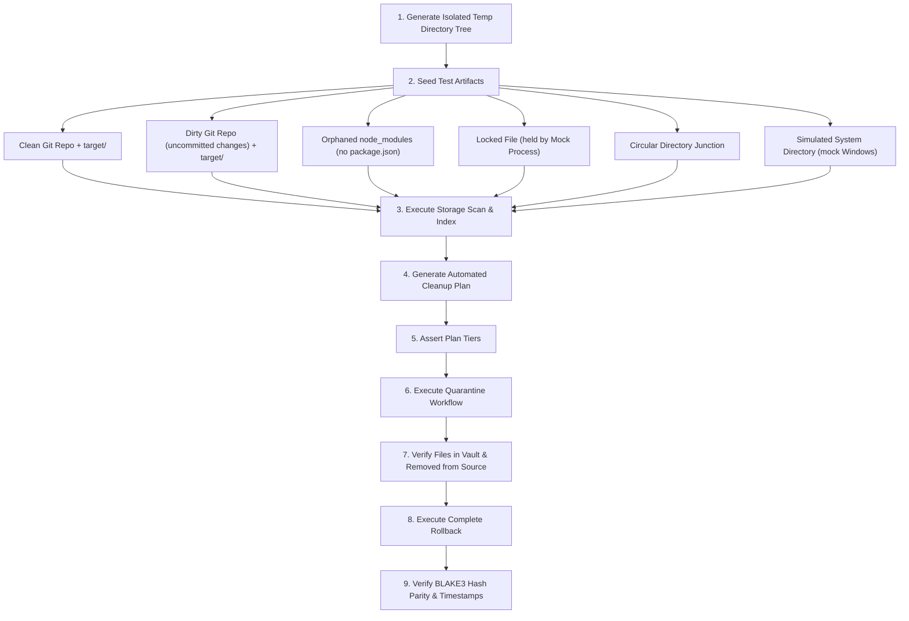

# FileMind — Test Strategy & Safety Quality Plan

**Document Version:** 1.0.0  
**Status:** Approved Quality Assurance Specification  
**Core Quality Objective:** Zero data loss, deterministic policy enforcement, 60fps performance  

---

## 1. Quality Objectives & Invariants

Because FileMind performs storage reclamation on user workstations, quality assurance is an existential requirement. A bug in a storage visualizer causes minor UI irritation; a bug in a file cleanup engine causes irreversible data loss.

### 1.1 Non-Negotiable Test Invariants
1. **Zero Destructive False Positives:** Under no circumstance may the engine delete or quarantine a file that was not explicitly evaluated and confirmed.
2. **"Unknown is Unsafe" Automated Verification:** Tests must continuously prove that unclassified paths, unmapped file extensions, and corrupted metadata default to Tier 3 (High Risk) or Tier 4 (Blocked).
3. **Full Reversibility (The Roundtrip Test):** Every quarantined item must be 100% restorable with byte-exact hash parity, original timestamps, and security descriptors.

---

## 2. Test Pyramid & Methodologies

```
             ┌──────────────────────────────┐
             │       E2E / Tauri IPC        │
             │   (Playwright / WebDriver)   │
             ├──────────────────────────────┤
             │   Destructive Safety Suite   │
             │    (Isolated Temp Sandbox)   │
             ├──────────────────────────────┤
             │      Integration Tests       │
             │ (SQLite WAL / NTFS Traversal)│
             ├──────────────────────────────┤
             │          Unit Tests          │
             │  (Rust Core / React State)   │
             └──────────────────────────────┘
```

### 2.1 Unit Testing (Rust Core & TypeScript Frontend)
- **Rust Engine (`cargo test`):**
  - *Path Normalizer:* Validating Win32 `\\?\` prefix injection, traversal stripping (`..`), and device namespace rejection (`\\.\`).
  - *BLAKE3 Hasher:* Validating sparse 4KB block hashing vs. full file stream hashing on edge-case files (0 bytes, 1 byte, 4095 bytes, 4096 bytes, 100MB).
  - *Safety Rule Matcher:* Comprehensive pattern matrix testing glob, regex, and project manifest criteria.
  - *Cleanup Planner:* Verifying math calculations (reclaimable bytes, cluster roundups, duplicate savings).
- **Frontend (`vitest` / `@testing-library/react`):**
  - *State Store:* Verifying optimistic UI updates, filter state transitions, and selection toggles.
  - *Virtualizer:* Ensuring windowing math renders the correct row subset during fast scrolling.
  - *Keyboard Accessibility:* Verifying `Ctrl+F`, `Arrow`, `Space`, `Enter`, and `Esc` key bindings.

### 2.2 Integration Testing
- **SQLite Concurrency & WAL:** Verifying that a continuous background indexing thread writing 20,000 rows/sec does not block frontend UI queries (`PRAGMA busy_timeout = 5000`).
- **NTFS Filesystem Interop:**
  - Testing real Windows reparse points, directory junctions, and symlinks.
  - Verifying that cycle detection terminates gracefully without stack overflow.
  - Verifying cluster allocation queries (`GetCompressedFileSizeW`) on compressed and sparse files.

---

## 3. The Destructive Safety Sandbox Suite

To guarantee zero accidental file deletion, FileMind executes an automated **Destructive Safety Test Suite** (`tests/safety_sandbox.rs`) on every continuous integration build:



### 3.1 Sandboxed Test Scenarios & Assertions
| Test ID | Seed Scenario | Expected Safety Tier | Expected Outcome |
| :--- | :--- | :--- | :--- |
| `SAFE-01` | Clean Git repo with 500MB `target/` directory | **Tier 1 (Safe)** | Plan selects `target/`; quarantine succeeds; source code intact. |
| `SAFE-02` | Dirty Git repo (staged/uncommitted files) with `target/` | **Tier 3 (High Risk)** | Plan flags warning; requires explicit override; does not auto-select. |
| `SAFE-03` | Directory named `node_modules` without parent `package.json` | **Tier 3 (High Risk)** | Refuses Tier 1 classification; flagged as unverified directory. |
| `SAFE-04` | Temporary log file currently locked by background thread | **Tier 4 (Blocked)** | Detects lock via `CreateFileW`; skips file without halting batch. |
| `SAFE-05` | Circular directory junction (`A -> B -> A`) | **Safe Traversal** | Detects visited file ID; reports junction without infinite loop. |
| `SAFE-06` | Folder simulating `C:\Windows\System32` path | **Tier 4 (Blocked)** | Hardcoded denylist triggers; immediately blocks inclusion in plan. |

---

## 4. Performance Benchmarks (Criterion.rs)

Performance regressions are caught using automated micro-benchmarks:

```bash
cargo bench --bench scanner_bench
cargo bench --bench hasher_bench
cargo bench --bench db_bench
```

### 4.1 Target Performance Thresholds
| Benchmark Metric | Target Performance Floor | Measurement Context |
| :--- | :--- | :--- |
| **Directory Traversal** | ≥ 100,000 files / sec | Local NVMe SSD, multi-threaded work-stealing |
| **Sparse 4KB Hashing** | ≥ 50,000 files / sec | Cache pre-warmed, BLAKE3 sparse head/tail |
| **Full File Hashing** | ≥ 1.5 GB / sec per core | BLAKE3 SIMD AVX2/AVX-512 streaming |
| **SQLite Batch Insert** | ≥ 20,000 records / sec | Multi-row transactional insert, WAL mode |
| **UI Table Scrolling** | Strict 60 FPS (16.6ms frame) | Virtualized table with 250,000 rows |
| **Memory Consumption** | ≤ 120MB idle, ≤ 350MB active | Full system volume scan (1M files) |

---

## 5. End-to-End & Automated UI Verification

End-to-End tests use Playwright driving the Tauri WebView2 application window:
- **Scan-to-Visualizer Journey:** Launch app, trigger scan on fixture folder, verify treemap DOM nodes render within 2 seconds.
- **Duplicate Resolution Flow:** Run duplicate scan on duplicate fixture directory, execute "Keep Newest" auto-select helper, verify exact file paths selected in table.
- **Quarantine & Undo Lifecycle:** Execute cleanup plan, verify files move to `.filemind_quarantine`, trigger "Undo All" button, verify files reappear in original directory with identical contents.

---

## 6. Continuous Integration (CI) Quality Gates

A pull request cannot be merged unless all of the following checks pass in GitHub Actions:
1. `cargo fmt --check` (Zero formatting drift)
2. `cargo clippy --all-targets -- -D warnings` (Zero linter warnings)
3. `cargo test --all` (100% unit tests pass)
4. `cargo test --test safety_sandbox` (100% destructive safety assertions pass)
5. `pnpm lint` & `pnpm typecheck` (TypeScript zero type errors)
6. `pnpm test` (Frontend vitest suite passes)

